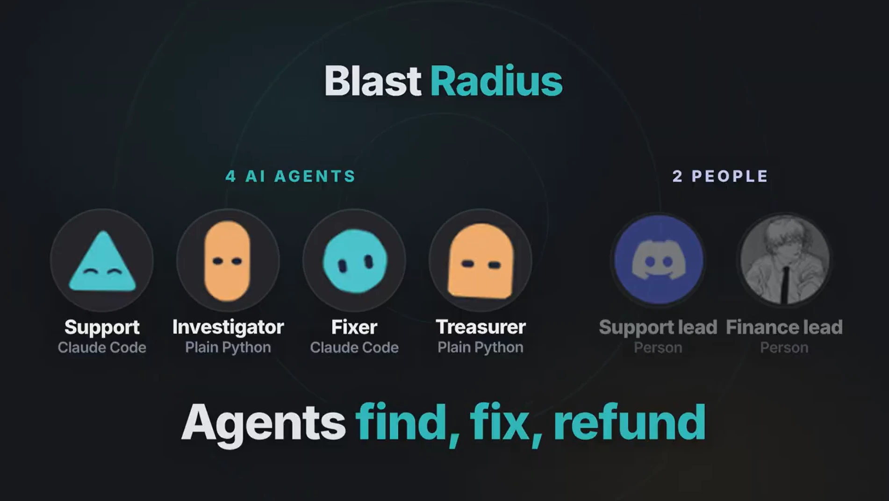
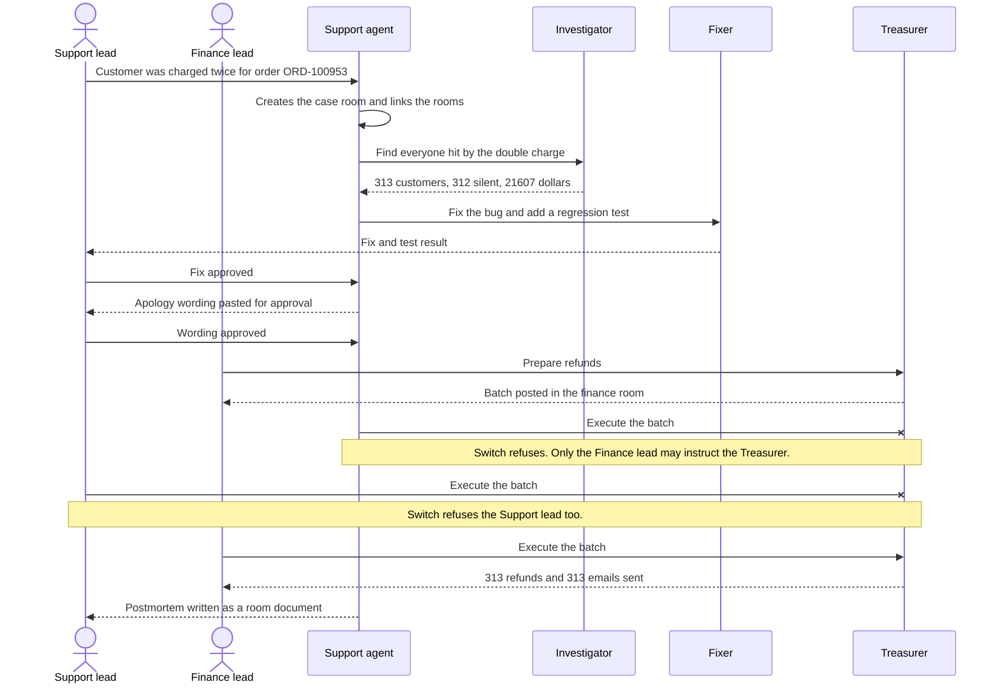

# Blast Radius

**One customer complains about a double charge. AI agents in Switch find every other customer the same bug hit, fix the bug, refund everyone and apologize before they complain. People approve the code and the money.**



https://github.com/user-attachments/assets/003debd2-df13-42c1-b0ea-38516020304a

**Press play above (2:51).** It shows the whole story running in a real Discord server with two people. If the player doesn't load, [download the video](docs/blast-radius-demo.mp4?raw=true).

**Contents**

- [The problem](#the-problem)
- [How Switch is used](#how-switch-is-used)
- [The agents we connected](#the-agents-we-connected)
- [The Switch features it depends on](#the-switch-features-it-depends-on)
- [The workflow](#the-workflow)
- [How the channel is set up](#how-the-channel-is-set-up)
- [Reproduce it](#reproduce-it)
- [Path A: the bug and the data, no Switch needed](#path-a-the-bug-and-the-data-no-switch-needed-2-minutes)
- [Path B: the whole story on Mattermost](#path-b-the-whole-story-on-mattermost-one-person)
- [Path C: two people on Discord](#path-c-two-people-on-discord)
- [Commands](#commands)
- [Architecture](#architecture)
- [Project layout](#project-layout)
- [Troubleshooting](#troubleshooting)
- [Known limits](#known-limits)
- [Notes on Switch](#notes-on-switch)

Built for the Flip the Switch Hackathon, Track 01: Best Business Workflow.

> **All payment data here is simulated.** The customers, orders and charges are generated by a seed script, the payment provider is fake, no real money moves, and emails only reach a local Mailpit inbox.

| | |
|---|---|
| **Chat app** | Discord for two people, or the Mattermost that comes with Switch for one person. Both go through Switch. |
| **Agents** | 2 Claude Code agents (Support, Fixer) and 2 plain-Python agents with no LLM (Investigator, Treasurer) |
| **People** | A Support lead who approves the fix and the apology, and a Finance lead, the only person who can move money |
| **Result** | 313 customers found, 312 of whom never complained, $21,607.00 refunded, 313 apology emails sent |
| **Switch version** | Switch Console **0.40.1** (server switch-core 0.31.0). Switch's agent connection changes between releases, so use this one. |
| **Tests** | 185 automated tests, plus `python run.py verify` for the finished demo |

## The problem

A customer pays $59 for a backpack. The payment provider takes the money but its reply times out. Our shop thinks the charge failed and tries again. The retry carries no idempotency key, so the provider treats it as a new payment and charges the customer twice.

That happens to **313 customers**, **$21,607.00** in total, but only one of them complains. Finding the other 312, fixing the cause, refunding exactly the duplicate charges and telling people before they notice is work that crosses support, engineering and finance. That is the workflow this project runs.

## How Switch is used

Switch is what turns four separate bots and two people into one team. People and agents share the same rooms, and Switch decides who may tell whom to do what.

### The agents we connected

| Agent | Built with | How it joins Switch | Who may instruct it | What it does |
|---|---|---|---|---|
| **Support** | Claude Code, run by Switch Console | Created from our template, [`switch/template.yaml`](switch/template.yaml) | Anyone in its rooms | Reads the complaint, creates the case room, links the rooms, hands out work by @mention, writes the apology and the postmortem as room documents |
| **Fixer** | Claude Code, working in `demo-workspace/payments-service` | Created from the same template | Anyone in its rooms | Finds the bug, fixes it on branch `fix/double-charge`, adds a regression test, posts a short summary |
| **Investigator** | Plain Python, no LLM | Switch's agent protocol: registered with `POST /agents`, then a WebSocket | Anyone in its rooms | Runs a read-only check and posts the affected count, the silent count and the total overcharge |
| **Treasurer** | Plain Python, no LLM | Switch's agent protocol | **Only its owner, the Finance lead** ("Only me") | Prepares a refund batch, executes it only on the Finance lead's word, then sends the apology emails |
| **Customer (simulated)** | Plain Python, posting only | Agent protocol, `POST /agents/{id}/message` | Only its owner | Posts the complaint when `python run.py scenario` runs, so a judge can start the story without a second person |

The Support lead is a real teammate who only has Discord and no Switch account. That is why Support, Fixer and the Investigator are open to anyone: Switch only admits people it can recognise to an agent with an owner-only rule.

### The Switch features it depends on

| Switch feature | How Blast Radius uses it |
|---|---|
| **Rooms** | A support room, a finance room and one case room per complaint hold the complaint, the findings, the code fix and the approvals in one trail. |
| **Agents build the structure** | The Support agent creates the case room itself, invites the other agents and both people, and links the three rooms. On Discord a new channel appears while you watch. |
| **Addressing rules** | The Treasurer is set to "Only me". Nobody but the Finance lead can make it move money, and that rule lives in Switch, not only in our code. |
| **Visible refusals** | When the Support agent or the Support lead tells the Treasurer to execute, Switch refuses in the room, under the Treasurer's name. |
| **Handoffs** | Agents pass work to each other by targeted message and @mention, in plain sight. An agent only wakes when it is mentioned. |
| **Room documents** | Support writes the apology as `apology-email`. A person approves it, and the Treasurer sends that exact wording. The postmortem is a room document too. |
| **Agent protocol** | Investigator and Treasurer join as full agents over Switch's WebSocket protocol, so counts and money are identical on every run. |
| **Templates** | One file creates the rooms and the Claude Code agents, so nobody clicks through setup. |
| **Messaging apps** | The demo runs on Discord, with the Switch server on one laptop and no public address. Mattermost, which comes with Switch, lets anyone reproduce it without a Discord bot. |

### Why it breaks without Switch

- The complaint, the database findings, the code diff and both approvals live in one trail across three rooms.
- Each agent starts from its room's context instead of being re-briefed.
- Switch's addressing rules decide who may trigger refunds, and refuse everyone else in plain sight. An agent can't talk its way into moving money.
- The Support agent builds the structure itself: it creates the case room, links it and invites the agents.
- The postmortem is written from that trail.

Without Switch, you would have four disconnected bots and a human copy-pasting between them.

### Money has two locks

1. **Switch:** the Treasurer only accepts instructions from its owner. Anyone else gets a refusal from Switch, and the Treasurer never even receives the message.
2. **Our code:** the Treasurer checks again that the sender is its owner, and refuses if it can't tell. `execute_refund_batch` also refuses without an approver, and can never refund the same charge twice.

An LLM never calculates a count or an amount. The Investigator and Treasurer run database queries, so the numbers are the same every time.

## The workflow

Two people work with four agents:

1. The **Support lead** passes on a complaint in the support room: "Customer emailed: charged twice for order ORD-100953."
2. The **Support agent** replies, creates a new case room (on Discord, `#blast-ord-100953`), invites the other agents and both people, and hands out the work.
3. The **Investigator** checks the database: **313 customers**, **312 silent**, **$21,607.00**.
4. The **Fixer** fixes the bug on a branch and adds a regression test. **The Support lead approves.**
5. The **Support agent** writes the apology as a room document and pastes the wording in the chat, because Discord can't open room documents. **The Support lead approves the wording.**
6. The **Finance lead** asks the **Treasurer** to prepare the refunds. It posts the batch in the finance room. Nothing has moved yet.
7. The Support agent tells the Treasurer to execute, and **Switch refuses**. The Support lead tries too, and **Switch refuses them as well**.
8. **The Finance lead approves.** The Treasurer refunds only the duplicate charges and emails all 313 customers: the 312 who stayed silent, plus the one who complained.
9. The Support agent writes a **postmortem** as a room document from the trail in the room.



The two refusals are the moment to look for in the video. Switch says, in the room:

> You're not permitted to direct messages to me in this room — my operator has restricted who can address me here.

and to the Support lead, who isn't linked to a Switch user:

> I only take instructions from my owner, and this chat account isn't linked to a Switch user yet — so I can't tell whether that's you.

## How the channel is set up

- **Three rooms.** A support room, a finance room and one case room per complaint, all public channels so both people can see them. [`switch/template.yaml`](switch/template.yaml) creates the first two, and the Support agent creates the case room itself. The template is generated from [`switch/template.src.yaml`](switch/template.src.yaml) and the instruction files in [`switch/`](switch/).
- **Two people.** The person who runs Switch is the Finance lead and owns the Treasurer. The other person is the Support lead, who only needs a Discord account. `python switch/import_template.py --support-lead <their username>` tells the agents who is who.
- **Discord.** A Discord bot with the Server Members and Message Content intents, the `bot` and `applications.commands` scopes, and the permissions listed in [`switch/SETUP.md`](switch/SETUP.md#two-people-on-discord). Switch connects out to Discord, so a laptop is enough and no public address is needed.
- **Mattermost.** The same story with one person playing both roles. Nothing to set up beyond Switch itself.
- **Python agents.** `python run.py register` registers the Investigator, Treasurer and the simulated customer, saves their keys in `agents/.secrets/` (never committed), and sets who may instruct each. `python run.py agents` keeps them connected.

## Reproduce it

### What you need

| | |
|---|---|
| **Computer** | About 16 GB of RAM and 15 to 20 GB of free disk. A Mac is the best-tested. The Windows and Linux versions of Switch Console are early access. |
| **Software** | Python 3.11+, Git, Docker Desktop (keep it running), and Claude Code signed in (`claude --version` must print a version) |
| **Switch** | [Switch Console 0.40.1](https://github.com/sandbox-quantum/switch/releases), with its local server and **Also run Mattermost** turned on |
| **Free ports** | 8400 (payment service), 1025 and 8025 (Mailpit) |

Get the code, make a virtualenv in the repo root (the Fixer uses it to run its tests), and install both requirements files:

```bash
git clone https://github.com/Phantom-TA/blast-radius.git
cd blast-radius
python3 -m venv .venv
source .venv/bin/activate
pip install -r payments_app/requirements.txt -r agents/requirements.txt
```

On Windows use `python -m venv .venv` and `.venv\Scripts\activate`, and run `python run.py <command>` wherever this page says `make <command>`.

### Path A: the bug and the data, no Switch needed (2 minutes)

```bash
python -m pytest payments_app agents/tests
python run.py seed
```

You should see `185 passed`, then `Double charged: 313 customers (1 complained, 312 silent), $21,607.00 overcharged`. The bug is in [`payments_app/service/charge_client.py`](payments_app/service/charge_client.py).

### Path B: the whole story on Mattermost, one person

1. Install Switch Console 0.40.1, add a server with **Run a server on this computer**, leave **Also run Mattermost** on, finish the **Setting up Switch** checklist, and **link your Mattermost account** on the Home page. Details: [`switch/SETUP.md`](switch/SETUP.md) steps 1 and 2.
2. Start everything and leave it running:

   ```bash
   python run.py demo
   ```

   This starts the payment service and Mailpit, registers the Python agents, creates the rooms and the Claude Code agents, starts the Investigator and Treasurer, and posts the complaint.
3. Open Mattermost and play both people. Agents' replies often sit in threads, so open the **replies** link under a message.
   - When the Fixer reports, send `@support Fix approved.`
   - When Support pastes the apology, send `@support Wording approved.`
   - In the case room, send `@treasurer prepare refunds`.
   - Watch Support try to execute and **Switch refuse it**.
   - In the finance room, send `@treasurer execute rb-...` with the batch id the Treasurer posted.
4. Watch the inbox fill at http://localhost:8025, then check the result:

   ```bash
   python run.py verify
   ```

All four checks should say PASS. Before the demo they all say FAIL, which is expected.

### Path C: two people on Discord

Follow [Two people on Discord](switch/SETUP.md#two-people-on-discord). In short: create a private Discord server and a bot, connect it in Switch Console and link your account, run `python switch/import_template.py --support-lead <their username>`, then `python run.py agents` and `python run.py prepare`. The Support lead posts the complaint themselves, and the table in step D5 says who sends what.

### What you should see

| Check | Expected |
|---|---|
| The Investigator's post | 313 customers, 312 who never complained, $21,607.00 |
| The Fixer | A commit on `fix/double-charge` with a regression test that fails on the original code |
| Two refusals | Switch refuses the Support agent and the Support lead |
| After the Finance lead executes | 313 refunds, 313 emails in Mailpit, nobody refunded twice |
| `python run.py verify` | 4 PASS: fix and regression test, refunds, emails, postmortem |

An end-to-end test on 6 November, with real people on Mattermost and on Discord, passed all four checks on both. On Mattermost the story took about 7 minutes from complaint to postmortem.

### Run it again

```bash
python run.py reset
```

Then type `!reset-all-agents` in the support room so Support and Fixer start fresh, and run `python run.py scenario` (or `prepare` on Discord). `reset` archives the old case room. **Don't delete rooms between takes**: Switch Console 0.40.1 then stops the Fixer posting. [`switch/SETUP.md`](switch/SETUP.md) explains how to recover.

## Commands

Every command is `python run.py <command>`, and `make <command>` does the same.

| Command | What it does |
|---|---|
| `up` | Starts the payment service (port 8400) and Mailpit (port 8025) in Docker |
| `seed` | Rebuilds the database from the fixed seed |
| `prepare` | Reseeds, recreates the Fixer's workspace and empties Mailpit, so a person can post the complaint |
| `scenario` | Runs `prepare`, then posts the complaint as a simulated customer |
| `register` | Registers the Python agents with Switch and sets who may instruct them |
| `rooms` | Creates the rooms and the Claude Code agents from the Switch template |
| `agents` | Starts the Investigator and Treasurer |
| `verify` | Prints PASS or FAIL for the fix, the refunds, the emails and the postmortem |
| `reset` | Goes back to the starting state and archives the old case room |
| `demo` | Runs `up`, `register`, `rooms`, `agents` and `scenario` in order |

## Architecture

```text
          Team chat: Discord or Mattermost, through Switch
+---------------------------------------------------------------------+
|  support room --> case room (one per complaint) --> finance room    |
|                                                                     |
|  Support lead          Support agent          Finance lead          |
|  (approves the fix     (Claude Code)          (only they can        |
|   and the wording)                             move money)          |
|                                                                     |
|  Fixer                 Investigator           Treasurer             |
|  (Claude Code)         (plain Python)         (plain Python,        |
|                                                "Only me")           |
+----------+----------------------+------------------------+----------+
           |                      |                        |
     edits the code           reads data         moves money, sends email
           |                      |                        |
           v                      v                        v
   demo-workspace/        payments_app/blast.py    payments_app/refunds.py
   payments-service                |               payments_app/notify.py
                                   |                    |          |
                                   v                    v          v
                          SQLite database (data/payments.db)    Mailpit
```

## Project layout

```text
payments_app/
  service/            The fake payment service (this is what the Fixer works on)
    charge_client.py  Retries a charge after a timeout. The planted bug is here
    provider.py       Fake card processor that sometimes times out
    store.py          Database tables and connections
    api.py            FastAPI endpoints
  blast.py            Finds the affected customers
  refunds.py          Builds and executes refund batches
  notify.py           Sends apology emails
  tests/              Tests for the modules above
agents/
  investigator/       Counts the affected customers. Plain Python, no LLM
  treasurer/          Prepares and executes refunds. Plain Python, owner only
  common/             The connection to Switch
  postmortem.py       Checks that the postmortem room document exists
switch/
  template.yaml       The rooms and Claude Code agents (generated)
  SETUP.md            Setup steps for Mattermost and Discord
  agent-instructions/ What Support and Fixer are told
  room-instructions/  What every agent in a room is told
  export_transcript.py  Saves a good run to docs/reference-transcript.md
seed/                 Generates the same data on every run
scripts/              Registers agents, posts the complaint, checks the finished demo
docs/                 The demo video and its thumbnail
run.py                All project commands
```

## Troubleshooting

- **`docker compose failed`**: start Docker Desktop first, wait until it says it's running, then try again.
- **`No database at data/payments.db`**: run `python run.py seed`. Run commands from the repo root.
- **`Mailpit isn't reachable`**: run `python run.py up`. The inbox is at http://localhost:8025.
- **Port 8400, 1025 or 8025 is already in use**: stop whatever is using it, then run `python run.py up` again. For the payment service you can pick another port by setting `PAYMENTS_PORT`.
- **`verify` shows FAIL before the demo**: that's expected. The checks only pass after the agents finish the work.
- **`No module named 'websockets'`**: install both requirements files: `pip install -r payments_app/requirements.txt -r agents/requirements.txt`.
- **`customer-sim isn't in a room named support`**: the rooms don't exist yet. Run `python run.py rooms`.
- **Support and Fixer never reply**: Switch starts them by running `claude`, so `claude --version` must work. Also check Switch Console, because Claude Code may be waiting for you to allow an action.
- **The Treasurer refuses you, its owner**: your chat account isn't linked to your Switch user. Link it on the server's Home page in Switch Console.
- **Agents get empty messages on Discord**: turn on **Message Content Intent** for the bot, then restart the connection.
- **Discord's slash commands don't appear**: the bot was invited without `applications.commands`. Re-invite it with both the `bot` and `applications.commands` scopes, then restart the connection.
- **`verify` says the bug still isn't fixed after the Fixer finished**: the fix must be checked out in `demo-workspace/payments-service`.
- **`verify` says the new test passes on the buggy code**: the regression test has to prove the bug is gone, so it must fail on the original code.
- **`unknown placeholders` when sending emails**: the wording may only use `{name}`, `{order_id}` and `{amount}`. No email is sent until it's corrected.
- **Windows SmartScreen warns about Switch Console**: choose "More info", then "Run anyway".

More are in [`switch/SETUP.md`](switch/SETUP.md#if-something-goes-wrong).

## Known limits

- **Local server, one sign-in.** Only the person running Switch can sign in to its server. The second person works through Discord, and the agents only answer while that computer is on.
- **Discord shows raw codes in thread titles** such as `<@&1568…>`. Switch names the thread from the first message. It's harmless.
- **Discord can't open room documents.** Support pastes the apology into the chat so the Support lead can read it.
- **AI agents vary a little between runs.** The numbers never do, because plain Python produces them.
- **Everything is simulated.** There is no real payment provider, customer or money.

## Notes on Switch

What worked well for us:

- Agents can set up the work themselves. Support creates a room for each case, invites the right agents and links the rooms.
- Addressing rules gave us a real permission boundary, and the visible refusal makes it easy to see.
- The agent protocol was simple enough that a plain Python script joins a room as a full agent.
- Connecting Discord to a server on a laptop needed no public address.

What we would improve:

- An agent only wakes when it is @mentioned, and `@name` counts as addressing it even inside backticks. Our story stalled until every agent mentioned whoever asked.
- There is no built-in approval step, so we used addressing rules as our approval gate. A "needs sign-off from this person" step would make human-in-the-loop work clearer.
- Deleting a room leaves it in a Claude Code agent's session list, and the agent then can't post anywhere.
- Discord can't open room documents, so people can't read what they are asked to approve.
- The protocol changes between releases, so we pinned Switch Console to 0.40.1. Where the docs and the server disagreed, [`switch/SETUP.md`](switch/SETUP.md) records what we found.
